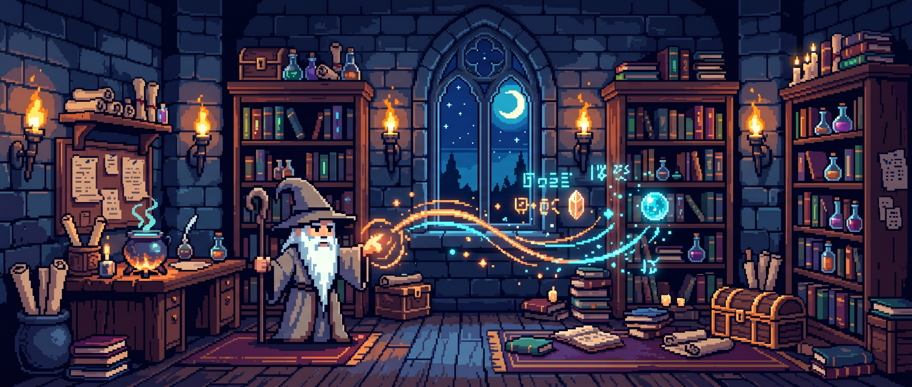
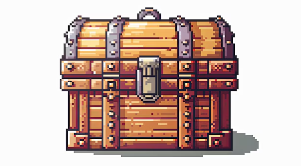
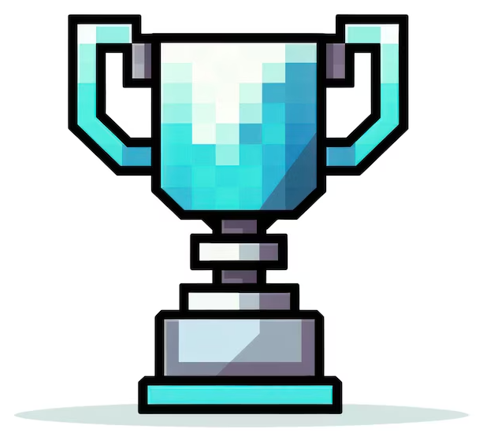
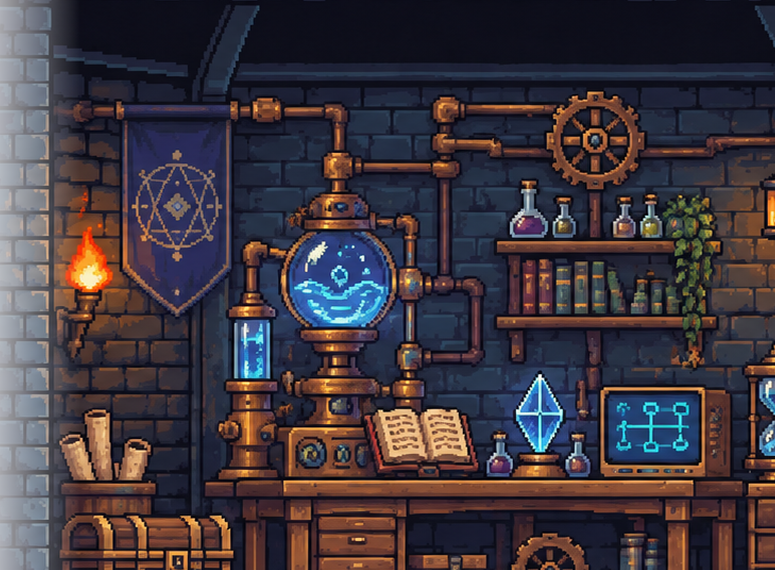

<h1 align="center">🏰 BEM-VINDO À TORRE DO ARQUIMAGO</h1>

  <strong>BRUNO BORGES · ARQUIMAGO VIBE CODE · NÍVEL 31</strong>

  
  
  

  <em>Ideias viram experimentos. Experimentos viram ferramentas.</em> 
  <em>E toda jornada precisa de um pouco de café. ☕</em>

  

<h2>📜 Ficha do Arquimago</h2>

<table width="100%">
  <tr>
    <th align="left" width="38%">Atributo</th>
    <th align="left" width="30%">Nível</th>
  
<td rowspan="11" width="32%" align="center" valign="middle" style="padding: 0;">

</td>
    
  </tr>
  <tr><td>🧙 Classe</td><td>Arquimago Vibe Code</td></tr>
  <tr><td>⭐ Nível</td><td>31</td></tr>
  <tr><td>✨ Gambiarra Arcana</td><td>+10</td></tr>
  <tr><td>☕ Alquimia de Café</td><td>+10</td></tr>
  <tr><td>🧠 Engenharia de Prompt</td><td>+8</td></tr>
  <tr><td>🔌 APIs</td><td>+8</td></tr>
  <tr><td>💤 Sono</td><td>-5</td></tr>
  <tr><td>🔮 Mana</td><td>-5</td></tr>
  <tr><td>🖥️ Resistência a telas azuis</td><td>Imune</td></tr>
  <tr><td>🌙 Visão noturna</td><td>00h–04h</td></tr>
</table>

<h3>🔮 Estado da Mana</h3>

<strong>Mana: -5 · Reservas arcanas em níveis críticos.</strong>

  Os tokens estão acabando depois de longas sessões de experimentação,
  desenvolvimento e invocação de modelos de inteligência artificial.
  O Arquimago continua trabalhando, mas cada novo prompt consome um pouco
  mais da reserva mágica.

  <strong>Recomendações:</strong> 
  ☕ Reforçar a alquimia de café. 
  💤 Recuperar algumas horas de sono. 
  🧠 Usar os tokens com sabedoria e evitar invocações desnecessárias.

<h2>🧰 Arsenal de Ferramentas</h2>

<table width="100%">
  <tr>
    <td width="68%" valign="middle">
      

        
        
        
        
        
        
        

      
<em>Ferramentas em uso, estudo e experimentação. O arsenal está sempre evoluindo.</em>

    </td>
  
  <td width="32%" align="center" valign="middle" style="padding: 0;">
  
</td>
    
  </tr>
</table>

<h2>📌 Missões Ativas</h2>

<table width="100%">
  <tr>
    <th align="left" width="24%">Projeto</th>
    <th align="left" width="48%">Missão</th>
    <th align="center" width="28%">Status</th>
    <td rowspan="4" width="30%" align="center" valign="middle">
      
    </td>
  </tr>
  <tr>
    <td><strong>Seek A.I</strong></td>
    <td>Sistema de captação imobiliária</td>
    <td align="center">🛠️ Em evolução</td>
  </tr>
  <tr>
    <td><strong>Automações</strong></td>
    <td>Integrações entre WhatsApp, fluxos, inteligência artificial e APIs.</td>
    <td align="center">⚗️ Em experimentação</td>
  </tr>
  <tr>
    <td><strong>Laboratório de IA</strong></td>
    <td>Assistentes, protótipos e novas experiências digitais.</td>
    <td align="center">🔮 Em criação</td>
  </tr>
</table>

<h2>🗺️ Próximas Missões</h2>

- [ ] Publicar novas versões dos projetos.
- [ ] Transformar experimentos em ferramentas úteis.
- [ ] Aprimorar integrações e automações.
- [ ] Continuar aprendendo, construindo e compartilhando.

<h2>☕ Ajude o Arquimago</h2>

  A mana está baixa e os tokens estão no fim! 
  Ofereça um café virtual e ajude o Arquimago a manter a forja acesa.

  

  

  Cada conta GitHub pode registrar um café virtual a cada 30 dias. É um gesto simbólico, sem pagamento.

  <em>“Toda grande criação começa com uma ideia, curiosidade e uma quantidade suspeita de café.”</em>
    
  THE VIBE CODE CHRONICLES

